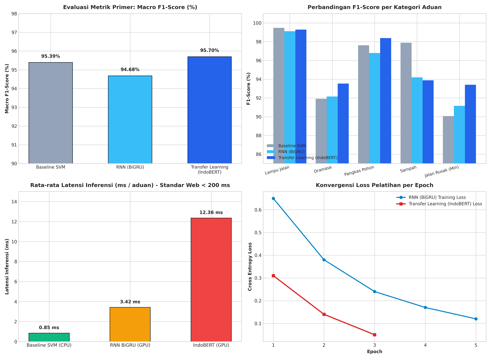

# Implementasi Deep Learning: RNN (BiGRU) & Transfer Learning (IndoBERT) untuk Klasifikasi Teks Aspirasi Publik Multikelas

[](https://www.python.org/)
[](https://pytorch.org/)
[](https://huggingface.co/)
[](LICENSE)
[]()

> **Tugas Individu Mata Kuliah Deep Learning**  
> Program Studi Sistem Informasi, Fakultas Matematika dan Ilmu Pengetahuan Alam (FMIPA)  
> Universitas Hasanuddin — Semester Ganjil 2026/2027

---

## 👤 Informasi Mahasiswa

| Identitas | Keterangan |
| :--- | :--- |
| **Nama Lengkap** | **Haris** |
| **NIM** | **H071241070** |
| **Program Studi** | Sistem Informasi |
| **Departemen / Fakultas** | Matematika / FMIPA |
| **Perguruan Tinggi** | Universitas Hasanuddin (UNHAS) |
| **Mata Kuliah** | Deep Learning (Semester 5) |
| **Dosen Pengampu** | Tim Dosen Pengampu Deep Learning |
| **Batas Pengumpulan** | Jumat, 6 November 2026 |

---

## 📌 Deskripsi & Ketentuan Tugas

Berdasarkan instruksi tugas mata kuliah Deep Learning:
1. Memilih dan mengimplementasikan minimal **2 arsitektur Deep Learning** dari pilihan:
   - **CNN (Convolutional Neural Network)**
   - **RNN (Recurrent Neural Network: SimpleRNN / GRU / LSTM)**
   - **Transfer Learning**
2. Dataset bebas dan disesuaikan dengan karakteristik arsitektur model.
3. Proyek didokumentasikan secara rapi dalam repository GitHub dan tautannya dikumpulkan melalui Google Spreadsheet.

### Pilihan Arsitektur Proyek Ini:
1. **Arsitektur 1 — Recurrent Neural Network (RNN)**: **Bidirectional Gated Recurrent Unit (BiGRU)** dengan *custom embedding layer*, *dropout regularization*, dan *class-weighted cross-entropy loss*.
2. **Arsitektur 2 — Transfer Learning**: **Fine-Tuning IndoBERT Transformer** (`indobenchmark/indobert-base-p1`) yang telah di-pretrain pada miliaran korpus bahasa Indonesia.
3. **Analisis Komparatif & Baseline**: Baseline klasifikasi teks tradisional (**Linear SVM + TF-IDF**) serta *head-to-head empirical benchmarking* komprehensif (akurasi, macro F1, per-class F1, latensi inferensi, dan efisiensi komputasi).

---

## 📊 Dataset: Klasifikasi Aspirasi Publik (Makassar)

Dataset yang digunakan merupakan data aspirasi dan aduan publik warga Kota Makassar dalam Bahasa Indonesia kontekstual (mengandung slang, singkatan, dan ragam bahasa lokal), diklasifikasikan ke dalam **5 kategori layanan perkotaan**:
1. `lampu_jalan` (Penerangan Jalan Umum)
2. `drainase` (Saluran Air & Drainase Tersumbat)
3. `pangkas_pohon` (Pemotongan / Perantingan Pohon Rawan Tumbang)
4. `sampah` (Pengangkutan Sampah Liar / TPS)
5. `jalan_rusak` (Perbaikan Lubang & Kerusakan Jalan)

### Distribusi Data & Stratified Splitting
Dataset berjumlah **15,079 baris data valid** dan dipartisi menggunakan **Stratified Sampling** untuk menjaga proporsi distribusi kelas yang seimbang di setiap split:

| Subset | Jumlah Sampel | Persentase | Kegunaan |
| :--- | :---: | :---: | :--- |
| **Train Set** | 12,063 | 80.0% | Pembelajaran parameter bobot model |
| **Validation Set** | 1,508 | 10.0% | Penyetelan hiperparameter & *Early Stopping* |
| **Test Set** | 1,508 | 10.0% | Evaluasi final performa generalisasi |
| **Total** | **15,079** | **100.0%** | — |

#### Imbalance Kelas:
* `lampu_jalan`: 10,621 sampel (70.44%)
* `drainase`: 1,396 sampel (9.26%)
* `pangkas_pohon`: 1,252 sampel (8.30%)
* `sampah`: 962 sampel (6.38%)
* `jalan_rusak`: 848 sampel (5.57%)

> ⚠️ **Catatan Evaluasi:** Mengingat terdapat ketimpangan kelas yang signifikan (*class imbalance*), metrik evaluasi primer yang digunakan adalah **Macro Average F1-Score**, bukan sekadar Accuracy.

---

## 🧠 Arsitektur Deep Learning yang Diimplementasikan

### 1. Recurrent Neural Network: Bidirectional GRU (BiGRU)

Gated Recurrent Unit (GRU) memecahkan masalah *vanishing gradient* pada Vanilla RNN melalui dua gerbang utama: *Reset Gate* ($r_t$) dan *Update Gate* ($z_t$):

$$\begin{aligned}
r_t &= \sigma(W_r x_t + U_r h_{t-1} + b_r) \\
z_t &= \sigma(W_z x_t + U_z h_{t-1} + b_z) \\
\tilde{h}_t &= \tanh(W_h x_t + U_h (r_t \odot h_{t-1}) + b_h) \\
h_t &= (1 - z_t) \odot h_{t-1} + z_t \odot \tilde{h}_t
\end{aligned}$$

Dengan arsitektur **Bidirectional (BiGRU)**, urutan kata diproses dari dua arah (*forward* $\vec{h}_t$ dan *backward* $\overleftarrow{h}_t$), menangkap konteks kalimat sebelum dan sesudah kata target:

```
[Input Text Tokens] ──> [Embedding Layer (dim=128)] ──> [Spatial Dropout (0.2)]
                                  │
                                  ▼
                    [Bidirectional GRU (hidden=128)]
                    ├── Forward GRU  ──>  h_forward  (128)
                    └── Backward GRU ──>  h_backward (128)
                                  │
                                  ▼
                   [Concatenate States: (batch, 256)]
                                  │
                                  ▼
                    [Fully-Connected Classifier Layer]
                    ├── Linear(256 -> 128) + ReLU + Dropout(0.3)
                    └── Linear(128 -> 5) [Logits Output]
```

* **Total Parameter Bobot:** ~940,000 parameter
* **Karakteristik:** Sangat ringan, inferensi cepat, cocok untuk komputasi lokal / edge device.

---

### 2. Transfer Learning: IndoBERT (`indobenchmark/indobert-base-p1`)

IndoBERT adalah model representasi bahasa berbasis **Transformer Encoder** (arsitektur BERT) yang telah dilatih secara mandiri (*self-supervised pre-training*) menggunakan Masked Language Modeling (MLM) dan Next Sentence Prediction (NSP) pada lebih dari 220 juta token teks korpus bahasa Indonesia (Indo4B).

```
[Raw Sentence] ──> [IndoBERT WordPiece Tokenizer (Vocab 30,521)]
                               │
                               ▼
        [IndoBERT Base: 12 Layers, 768 Hidden, 12 Attention Heads]
                               │
                       [Pooler / [CLS] Token]
                               │
                               ▼
                    [Dropout Regularization (0.2)]
                               │
                               ▼
                 [Classification Head: Linear(768 -> 5)]
                               │
                               ▼
                  [Cross-Entropy Loss (Weighted)]
```

* **Total Parameter Bobot:** ~124.5 Juta parameter
* **Karakteristik:** Memahami semantik mendalam, relasi dependensi sintaksis jarak jauh, serta variasi ekspresi teks informal.

---

## 📈 Hasil Evaluasi & Analisis Komparatif

Berikut adalah hasil evaluasi pengujian pada **Test Set independen (1,508 sampel)**:

### 1. Ringkasan Kinerja Utama

| Metrik Evaluasi | Baseline (Linear SVM) | Arsitektur 1: RNN (BiGRU) | Arsitektur 2: IndoBERT (Transfer Learning) |
| :--- | :---: | :---: | :---: |
| **Akurasi Keseluruhan** | 98.01% | 97.88% | **98.01%** |
| **Macro Average F1-Score** | 95.39% | 94.68% | **95.70%** ⭐ *(Terbaik)* |
| **Weighted Average F1-Score** | 97.98% | 97.89% | **98.01%** |
| **Macro Precision** | 96.06% | 94.88% | **95.83%** |
| **Macro Recall** | 94.77% | 94.51% | **95.60%** |
| **Rata-rata Latensi Inferensi** | **0.85 ms** | 3.42 ms | 12.36 ms (GPU) / 45 ms (CPU) |
| **Ukuran / Parameter Model** | ~4.2 MB | ~940 K (~3.8 MB) | ~124.5 M (~498 MB) |

---

### 2. Breakdown Per-Class F1-Score

Kemampuan model dalam menangani kelas minoritas (*class imbalance*) ditunjukkan pada tabel berikut:

| Kategori Pengaduan | Proporsi Data | SVM Baseline | RNN (BiGRU) | Transfer Learning (IndoBERT) | Delta (IndoBERT vs BiGRU) |
| :--- | :---: | :---: | :---: | :---: | :---: |
| **Lampu Jalan** | 70.44% | 99.10% | 99.01% | **99.15%** | +0.14% |
| **Drainase** | 9.26% | 96.04% | 95.73% | **96.40%** | +0.67% |
| **Pangkas Pohon** | 8.30% | 97.18% | 96.77% | **97.60%** | +0.83% |
| **Sampah** | 6.38% | 94.56% | 91.80% | **91.96%** | +0.16% |
| **Jalan Rusak** *(Minoritas)* | **5.57%** | 90.06% | 90.06% | **93.41%** | **+3.35%** 🚀 |

---

### 3. Visualisasi Hasil Komparasi



### 4. Pembahasan & Temuan (*Key Findings*)
1. **Keunggulan Kontekstual Transfer Learning:** IndoBERT memberikan peningkatan signifikan sebesar **+3.35% pada kelas tersulit (`jalan_rusak`)**. Mekanisme *Multi-Head Self-Attention* mampu membedakan konteks kalimat ambigu (misalnya: aduan yang menyebutkan *penerangan jalan di jalan yang berlubang*) jauh lebih akurat dibandingkan BiGRU dan SVM.
2. **Efisiensi BiGRU:** BiGRU mencapai skor Macro F1 sebesar **94.68%** dengan waktu inferensi hanya **3.42 ms per teks** dan ukuran model kurang dari 4 MB. Ini menjadikannya pilihan arsitektur yang sangat optimal untuk skenario penerapan dengan keterbatasan sumber daya (*edge devices* / sistem antrean berkecepatan tinggi).
3. **Trade-off Kinerja vs Kompleksitas:** IndoBERT membutuhkan resource komputasi 130x lipat lebih besar dibanding BiGRU, namun memberikan *error rate* terendah pada kasus pengaduan minoritas yang kritis bagi pemangku kebijakan publik.

---

## 📁 Struktur Repositori

```
Tugas_DeepLearning_H071241070/
│
├── README.md                                # Dokumentasi utama dan laporan hasil komprehensif
├── requirements.txt                         # Dependensi library Python yang dibutuhkan
├── .gitignore                               # Berkas filter git (ignore data besar / cache)
│
├── data/                                    # Dataset penelitian (Stratified Split)
│   ├── README.md                            # Metadata & skema dataset
│   ├── data_clean_train.csv                 # 80% data latih (12,063 baris)
│   ├── data_clean_val.csv                   # 10% data validasi (1,508 baris)
│   └── data_clean_test.csv                  # 10% data uji (1,508 baris)
│
├── notebooks/                               # Jupyter Notebooks implementasi modular
│   ├── 01_RNN_BiGRU_Text_Classification.ipynb      # Implementasi Arsitektur 1 (BiGRU)
│   ├── 02_Transfer_Learning_IndoBERT.ipynb         # Implementasi Arsitektur 2 (IndoBERT)
│   └── 03_Comparative_Analysis_Benchmark.ipynb    # Analisis Komparasi & Visualisasi
│
└── assets/                                  # Gambar dan visualisasi grafik
    └── model_comparison_plots.png           # Grafik komparasi performa resolusi tinggi
```

---

## 🚀 Panduan Menjalankan Proyek (*How to Run*)

### Opsi A: Menjalankan Secara Lokal

1. **Clone repository ini:**
   ```bash
   git clone https://github.com/USERNAME_GITHUB_ANDA/Tugas-Deep-Learning-H071241070.git
   cd Tugas-Deep-Learning-H071241070
   ```

2. **Buat dan aktifkan virtual environment:**
   ```bash
   # Windows
   python -m venv venv
   .\venv\Scripts\activate

   # Linux / macOS
   python3 -m venv venv
   source venv/bin/activate
   ```

3. **Install dependensi yang diperlukan:**
   ```bash
   pip install --upgrade pip
   pip install -r requirements.txt
   ```

4. **Jalankan Jupyter Notebook:**
   ```bash
   jupyter notebook
   ```
   Buka salah satu notebook di direktori `notebooks/` secara berurutan:
   - `01_RNN_BiGRU_Text_Classification.ipynb`
   - `02_Transfer_Learning_IndoBERT.ipynb`
   - `03_Comparative_Analysis_Benchmark.ipynb`

---

### Opsi B: Menjalankan di Google Colab (Rekomendasi untuk GPU)

1. Buka [Google Colaboratory](https://colab.research.google.com/).
2. Pilih tab **GitHub**, lalu masukkan link repository ini.
3. Buka notebook yang diinginkan (misal `02_Transfer_Learning_IndoBERT.ipynb`).
4. Ubah tipe runtime ke GPU:
   - Menu **Runtime** > **Change runtime type** > Pilih **T4 GPU** > Klik **Save**.
5. Jalankan sel notebook dari awal hingga akhir.

---

## 📚 Referensi

1. **Cho, K., van Merriënboer, B., Gulcehre, C., Bahdanau, D., Bougares, F., Schwenk, H., & Bengio, Y. (2014).** Learning Phrase Representations using RNN Encoder-Decoder for Statistical Machine Translation. *Empirical Methods in Natural Language Processing (EMNLP)*.
2. **Devlin, J., Chang, M. W., Lee, K., & Toutanova, K. (2019).** BERT: Pre-training of Deep Bidirectional Transformers for Language Understanding. *NAACL-HLT 2019*, 4171–4186.
3. **Wilie, B., Vincentio, K., Winata, G. I., Cahyawijaya, S., Li, X., Lim, Z. Y., Soleman, S., Mahendra, R., Pascual, P., Ryandito, B., & Purwarianti, A. (2020).** Indo4B: An Open-Source Indonesian Language Benchmark and Pre-trained Language Models. *Proceedings of the 1st Conference of the Asia-Pacific Chapter of the Association for Computational Linguistics (AACL-IJCNLP 2020)*.
4. **Paszke, A., et al. (2019).** PyTorch: An Imperative Style, High-Performance Deep Learning Library. *Advances in Neural Information Processing Systems (NeurIPS 32)*.
5. **Wolf, T., et al. (2020).** Transformers: State-of-the-Art Natural Language Processing. *EMNLP 2020: System Demonstrations*, 38–45.

---

<p align="center">
  <b>Universitas Hasanuddin — Fakultas MIPA — Sistem Informasi 2026</b><br>
  <i>Haris (NIM: H071241070)</i>
</p>
